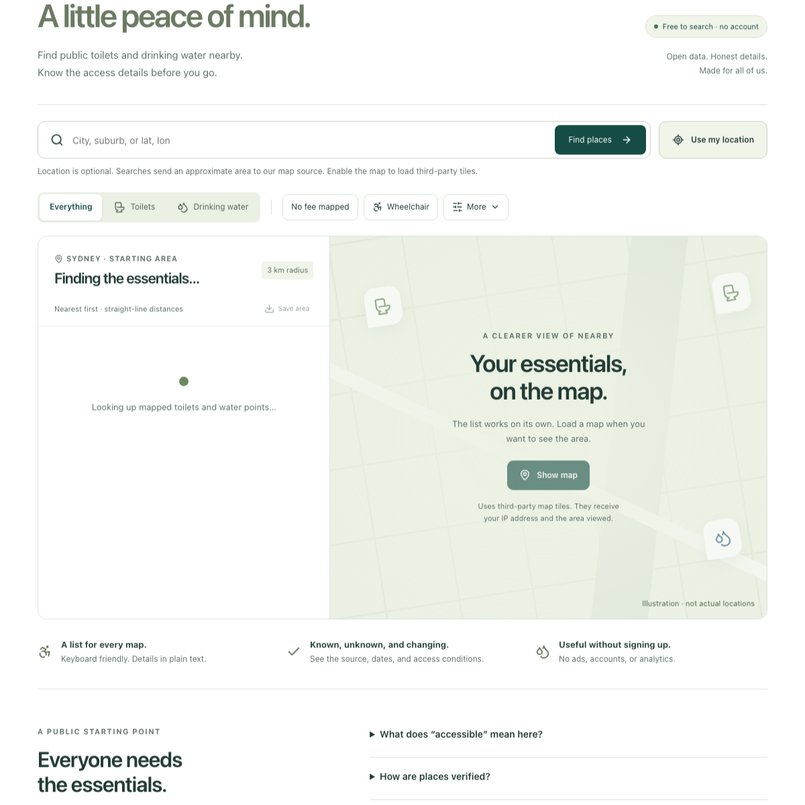

# Initial interface

The interface puts finding a toilet or water point first, with the same results in a list and an optional map. A quiet green palette, distinct toilet/water symbols, plain access language and generous controls aim to help someone making a quick decision outdoors. Type sizes, text wrapping, focus rings, reduced motion and high-contrast modes receive explicit styles.

The image below is a **static render of the actual React initial shell**, inspected at 1200 CSS pixels. It shows the initial loading state, not successful live data, an interactive browser test, or field verification. A 390-pixel static render was also inspected. Renderer-only adaptations removed the page background and viewport-height modal limit to fit the inline rendering surface; application source styling remains unchanged.

The design follows the familiar navigation, clear feedback, recovery and assistive-alternative principles in Alex's Human Interface Craft reference. A human accessibility and browser audit remains part of pilot readiness.
